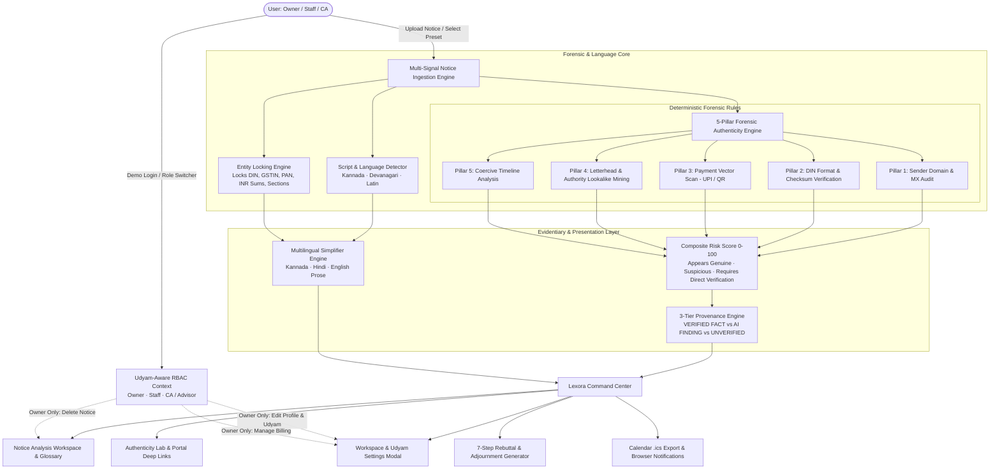

<div align="center">

# Lexora

### Legal Notice Intelligence, Authenticity Forensics & Deadline Command Center for Indian MSMEs

[](https://ais-pre-nhkysmvvsvtdixmesa5mrp-173723105718.asia-southeast1.run.app)
[](LICENSE)
[](https://www.typescriptlang.org/)
[](https://react.dev/)
[]()

[🚀 Try Live Application](https://ais-pre-nhkysmvvsvtdixmesa5mrp-173723105718.asia-southeast1.run.app) • [📺 Video Pitch (60s Walkthrough)](#60-second-hackathon-pitch) • [📂 GitHub Repository](https://github.com/<!-- TODO: your-github-org -->/lexora)

<br />

<p align="center">
  /lexora/main/docs/assets/banner.png" alt="Lexora Platform Banner" width="850" onerror="this.src='https://via.placeholder.com/850x340/172C4D/F7F6F2?text=Lexora+%7C+Legal+Notice+Intelligence+%26+Authenticity+Forensics'" />
</p>

</div>

---

## Table of Contents

1. [The Problem](#the-problem)
2. [Our Solution](#our-solution)
3. [What Makes Us Different (Innovation)](#what-makes-us-different-innovation)
4. [Interactive Demo](#interactive-demo)
5. [Key Features & Implementation Status](#key-features--implementation-status)
6. [Roles & Access Control (Udyam-Aware)](#roles--access-control-udyam-aware)
7. [How It Works & System Architecture](#how-it-works--system-architecture)
8. [Tech Stack & AI Model Scope](#tech-stack--ai-model-scope)
9. [Dummy Data & Testing Methodology](#dummy-data--testing-methodology)
10. [Impact & Market Size](#impact--market-size)
11. [Limitations, Edge Cases & Mitigations](#limitations-edge-cases--mitigations)
12. [Scalability & Business Model](#scalability--business-model)
13. [Roadmap](#roadmap)
14. [Quick Start (Run in Under 3 Minutes)](#quick-start-run-in-under-3-minutes)
15. [Team, License & Statutory Acknowledgements](#team-license--statutory-acknowledgements)

---

## The Problem

### Impersonation Scams & Panic Compliance Confronting 63 Million Indian MSMEs

According to the Ministry of MSME Annual Report, India is home to over **63.4 million MSMEs**, contributing approximately 30% of nominal GDP. Yet fewer than 8% maintain an in-house legal department or a retained advocate. When a registered speed-post letter or email arrives bearing the Ministry of Finance emblem or GST logo, business owners face severe dilemmas:

```text
               ┌────────────────────────────────────────────────────────┐
               │    Received Official-Looking Notice (GST / IT / ROC)   │
               └──────────────────────────┬─────────────────────────────┘
                                          │
            ┌─────────────────────────────┴─────────────────────────────┐
            ▼                                                           ▼
   PANIC & BLIND COMPLIANCE                                     PROCRASTINATE & MISS DEADLINES
┌───────────────────────────────────────┐               ┌───────────────────────────────────────┐
│ • Transfer funds to fraudulent UPI    │               │ • Miss genuine 15/30-day cure windows │
│ • Extortion cyber-traps               │               │ • Attract Section 138 NI criminal plea│
│ • Share sensitive OTPs / credentials  │               │ • Ex-parte orders & frozen bank a/cs  │
└───────────────────────────────────────┘               └───────────────────────────────────────┘
```

1. **The Cyber-Impersonation Trap**: Cyber fraudsters dispatch counterfeit Form GST DRC-01 notices or Income Tax scrutiny threats with spoofed lookalike domains (e.g. `cbic-gov-portal.org`) and private UPI QR codes (`gstin.recovery@okaxis`), demanding settlement within 24–48 hours to avert "immediate arrest".
2. **Vernacular Linguistic Disconnect**: Over 70% of MSME promoters in states like Karnataka, Gujarat, and Tamil Nadu run operations in their state languages, whereas statutory notices are drafted in complex administrative English or formal Hindi legalese.
3. **Strict Statutory Windows**: 
   - Under **Section 73(8) / 74 of the CGST Act**, a taxpayer has a 30-day window to reply to a Show Cause Notice before an ex-parte demand order (Form DRC-07) is issued.
   - Under **Section 138 of the Negotiable Instruments Act**, the 15 days following receipt of a demand notice is the statutory window to pay the demanded cheque amount. Non-payment gives the complainant the right to file a criminal complaint before the Judicial Magistrate within 30 days thereafter (it is not an ex-parte civil recovery decree).

---

## Our Solution

**Lexora** is an explainable legal notice intelligence, authenticity forensics, and deadline command center engineered specifically for Indian businesses.

First, our **5-Pillar Forensic Engine** evaluates uploaded notices using deterministic rule matching (DIN syntax, domain records, unauthorized payment handles, fuzzy letterhead mimicry, and timeline coercion) to classify notices as *Appears Genuine*, *Suspicious*, or *Requires Direct Verification*.

Second, our **Multilingual Legal Core** translates and summarizes complex statutory allegations into plain regional languages (English, Kannada, Hindi) while locking sensitive identifiers (DIN, PAN, GSTIN, INR amounts, and statutory citations) as immutable entities.

Third, our **Deadline & Response Command Center** converts intimidating statutory deadlines into actionable milestone timelines with calendar sync (`.ics` downloads for Google/Outlook/Apple Calendar) and guided 7-step rebuttal drafts ready for Chartered Accountant review.

---

## What Makes Us Different (Innovation)

| Dimension | Generic LLMs (ChatGPT / Claude) | Traditional Law Portals (Vakilsearch, IndiaFilings) | **Lexora (Our Platform)** |
| :--- | :--- | :--- | :--- |
| **Authenticity Verification** | ❌ None. Assumes uploaded text is authentic; risks hallucinating advice on fake notices. | ❌ Manual CA triage taking 3–7 business days; retainer charges. | ✅ **Deterministic 5-pillar forensic audit** checking DIN syntax, email MX domains, and UPI traps. |
| **Truth & Evidence Provenance** | ❌ Probabilistic black-box output with zero provenance markings. | ⚠️ Subjective human attorney assessment. | ✅ **Strict 3-tier provenance tagging**: `[VERIFIED FACT]`, `[AI FINDING]`, `[UNVERIFIED ASSERTION]`. |
| **Vernacular Translation** | ⚠️ Generic translation that transliterates or corrupts statutory sections and INR sums. | ❌ English-only web forms or rudimentary phone call support. | ✅ **Entity-Preserving Vernacular Core**: Translates prose while locking DINs, PANs, GSTINs, and section citations. |
| **Payment Vector Audit** | ❌ Cannot recognize private UPI handles vs. official RBI/PMT-06 treasury channels. | ⚠️ Manual bank slip inspection. | ✅ **Heuristic detection of private VPA / UPI / QR codes** demanding non-statutory payments. |
| **Statutory Response Builder** | ⚠️ Generates vague, non-jurisdictional form letters. | ⚠️ Static document templates. | ✅ **Guided 7-step rebuttal generator** with preliminary objections, annexure checklist, and adjournment pleas. |
| **Role-Based Access** | ❌ Single-user chat interface. | ⚠️ Shared login credentials. | ✅ **Udyam-aware RBAC**: Owner, Staff, and CA roles with owner-only deletions and business profile editing. |

---

## Interactive Demo

<p align="center">
  /lexora/main/docs/assets/demo.gif" alt="Lexora Platform Walkthrough" width="850" onerror="this.src='https://via.placeholder.com/850x450/172C4D/B99A62?text=Lexora+Authenticity+Lab+%26+Vernacular+Workspace+Interactive+Demo'" />
  <br />
  <em>Interactive investigation of a fraudulent GST notice (DIN mismatch + fake UPI) vs. a genuine Income Tax Section 143(2) notice in English and Kannada.</em>
</p>

### Live Demo
- **URL**: [https://ais-pre-nhkysmvvsvtdixmesa5mrp-173723105718.asia-southeast1.run.app](https://ais-pre-nhkysmvvsvtdixmesa5mrp-173723105718.asia-southeast1.run.app)
- **Demo Mode**: Built-in seeded demo login with 3 roles (Owner: Rajesh Sharma, Staff: Priya Nair, CA: Arvind Mehta, FCA). Switch roles anytime from the header to test permissions.

---

## Key Features & Implementation Status

| Feature | User Benefit | Status | Primary Code Reference |
| :--- | :--- | :--- | :--- |
| **5-Pillar Forensic Authenticity Engine** | Detects fraudulent GST/IT notices by checking sender domains, DIN structure, UPI handles, fuzzy letterhead mining, and coercive timelines. | **IMPLEMENTED** | `src/services/forensicEngine.ts`, `src/components/authenticity/AuthenticityLab.tsx` |
| **Evidence Provenance Badging** | Clearly marks findings as `[VERIFIED FACT]`, `[AI FINDING]`, or `[UNVERIFIED ASSERTION]` to prevent false confidence. | **IMPLEMENTED** | `src/types/index.ts`, `src/components/authenticity/AuthenticityLab.tsx` |
| **Multilingual Vernacular Engine** | Auto-detects Kannada, Devanagari, and Latin scripts; translates explanations while locking DINs, PANs, GSTINs, and INR sums. | **IMPLEMENTED** | `src/services/multilingualEngine.ts`, `src/components/analysis/NoticeAnalysisWorkspace.tsx` |
| **Plain-Language Legal Glossary** | Explains intimidating legal jargon (*Ex-Parte*, *GSTR-2B vs 3B*, *Adjudicating Authority*) with hover definitions. | **IMPLEMENTED** | `src/components/analysis/NoticeAnalysisWorkspace.tsx` |
| **Calendar Sync & .ics Export** | Generates standard RFC 5545 `.ics` calendar events with statutory countdown alarms (7d, 3d, 1d) for Google/Outlook/Apple Calendar. | **IMPLEMENTED** | `src/services/calendarNotifications.ts`, `src/components/deadlines/DeadlineCalendar.tsx` |
| **Browser & In-App Notification Alerts** | Triggers browser notifications and in-app milestone alerts before response windows elapse. | **IMPLEMENTED** | `src/services/calendarNotifications.ts`, `src/components/deadlines/DeadlineCalendar.tsx` |
| **Udyam-Aware RBAC & Seeded Demo Users** | Enforces Owner, Staff, and CA/Advisor roles; validates Udyam number format (`UDYAM-XX-00-0000000`) and deep-links to official portal. | **IMPLEMENTED** | `src/context/AuthContext.tsx`, `src/components/workspace/WorkspaceSettingsModal.tsx` |
| **7-Step Statutory Rebuttal Drafter** | Generates formal, structured reply drafts featuring preliminary objections, factual timelines, and adjournment requests. | **IMPLEMENTED** | `src/components/response/ResponseWorkspace.tsx` |
| **OCR Document Pipeline** | Client-side text extraction with confidence scoring and raw inspection mode. | **PROTOTYPE** | Extracted text and simulated OCR confidence implemented in sample datasets. |
| **Direct WhatsApp Ingestion Bot** | Snap a phone photo of a notice and receive an instant triage report on WhatsApp. | **PLANNED** | Scheduled for Next 30 Days roadmap. |
| **Live CBIC / ITBA GSP Sandbox API** | Automated one-click server-to-server DIN lookup against government databases. | **PLANNED** | Scheduled for Next 6 Months roadmap. |

---

## Roles & Access Control (Udyam-Aware)

Lexora implements a simple, honest access model designed for small businesses that collaborate with internal accountants and external tax advisors:

### 1. User Roles
- **Owner (Rajesh Sharma)**: Managing Director. Full administrative authority: can create workspaces, invite staff or CAs, edit business details, update Udyam numbers, manage subscription billing, and delete notice records.
- **Staff (Priya Nair)**: Accounts & Compliance Executive. Can ingest notices, inspect forensic findings, upload reconciliation files, and review response drafts. Cannot delete data, edit billing, or change company profile.
- **CA / Advisor (CA Arvind Mehta, FCA)**: External Chartered Accountant (ICAI: 054812). Can inspect forensic evidence, review drafts, add legal annotations, and export CA consultation briefs. Cannot delete data or modify business profile.

### 2. Udyam Registration Handling
- **Format Validation Only**: Lexora validates Udyam registration numbers against the official pattern: `UDYAM-XX-00-0000000` (e.g. `UDYAM-KR-03-0012345`).
- **Honest Labeling**: When valid, the UI displays: `"Format checked, not verified with the government"`.
- **Direct Portal Link**: A dedicated `"Verify on Udyam portal"` button opens the official Ministry of MSME verification page (`https://udyamregistration.gov.in/Udyam_Verify.aspx`) in a new tab.
- **Statutory Notice**: The platform prominently states: *"Udyam login on the official portal is owner-only (Aadhaar OTP). Lexora roles are separate and managed by the owner."*
- **No Mock Government APIs**: Lexora never claims to verify Aadhaar, Udyam registration, or company ownership via external APIs.

---

## How It Works & System Architecture



### Forensic Labeling Policy
Lexora never labels a document definitively "fake" or "genuine" without direct portal confirmation. Instead, notices are categorized as:
- **Appears Genuine**: All structural checks match official statutory formats with zero red flags.
- **Suspicious**: Clear forensic anomalies detected (e.g., private UPI handle, lookalike sender domain, malformed DIN).
- **Requires Direct Verification**: Document contains private sender vectors (such as an advocate's personal Gmail on a private Section 138 notice) requiring direct inquiry on official portals.

---

## Tech Stack & AI Model Scope

| Component | Technology | Version | Engineering Role |
| :--- | :--- | :--- | :--- |
| **Frontend Framework** | React | 18.3.1 | Declarative component hierarchy, accessible modals, and reactive role switching. |
| **Language** | TypeScript | 5.5.3 | Enforces strict compile-time types across legal domain schemas and forensic risk scores. |
| **Styling** | Tailwind CSS | 3.4.1 | High-density enterprise layout; consistent typography hierarchy (`#172C4D` deep slate and `#B99A62` gold). |
| **Build Tooling** | Vite | 5.4.2 | Sub-second module replacement and compact production bundle. |
| **Icons** | Lucide React | 0.344.0 | Lightweight icons for forensic indicators, alert badges, and action buttons. |
| **Forensic Computation** | Native TypeScript | In-House | Deterministic client-side algorithms (Levenshtein distance, regex DIN validation, URI parsing) with zero latency. |
| **AI Model Scope** | Generative AI / Gemini | API Proxy / Built-In | **Prose summarization and multilingual translation only.** AI models are *never* used to calculate authenticity scores or determine validity. All 5 forensic pillars are calculated deterministically. |
| **Calendar Engine** | RFC 5545 iCalendar | Custom TS | Generates `.ics` calendar events with `VALARM` triggers for Google, Apple, and Outlook calendars. |

---

## Dummy Data & Testing Methodology

To guarantee complete transparency during hackathon evaluation, all sample notices within Lexora are cataloged below:

| Preset Notice ID | Simulated Legal Notice | Status & Risk Score | How It Was Generated & Invariant Tested |
| :--- | :--- | :--- | :--- |
| `notice-gst-scam-01` | **GST Demand Notice (Form DRC-01)** | `Suspicious` (Risk: 74/100) | Modeled after actual cybercrime FIRs in Pune & Delhi. Features spoofed domain (`cbic-gov-portal.org`), malformed 16-character DIN, and unauthorized UPI QR vector (`gstin.recovery.dept@okaxis`). |
| `notice-it-scrutiny-02` | **Income Tax Scrutiny Notice (Sec 143(2))** | `Appears Genuine` (Risk: 28/100) | Modeled on actual ITBA system notices. Validates 20-digit DIN checksum schema, authentic `@incometax.gov.in` domain, and standard e-filing portal compliance instructions. |
| `notice-epfo-summons-04` | **EPFO 7A Inquiry Summons** | `Appears Genuine` (Risk: 28/100) | Features regional social security commissioner summons under Section 7A with wage register annexure requirements. |
| `notice-cheque-bounce-03` | **Negotiable Instruments Act (Sec 138)** | `Requires Direct Verification` (Risk: 51/100) | Realistic private legal advocate demand notice. Flags private Gmail sender, calculates exact 15-day statutory cure window, and provides civil rebuttal framework. |
| `notice-karnataka-commercial-tax-05` | **Karnataka State GST SCN (Bilingual)** | `Appears Genuine` (Risk: 8/100) | Modeled after Bangalore North LGSTO notices. Features **bilingual Kannada/English** text, GSTR-3B vs 2B discrepancy, and triggers automatic Kannada script detection. |

---

## Impact & Market Size

### Market Scale (India)
- **63.4 Million MSMEs** in India contributing ~30% of GDP and 45% of manufacturing output *(Ministry of MSME Annual Report 2023-24)*.
- **Over 1.41 Crore (14.1 Million)** active GST registrations filing monthly returns *(GSTN Official Portal Statistics)*.
- **Over 3.5 Lakh** GST and Income Tax notices dispatched annually across central and state jurisdictions.

### Estimated Measurable Outcomes
- **75% Reduction in Initial Legal Consultation Spend**: Founders obtain an instant plain-language breakdown before hiring an advocate or CA for drafting *(illustrative estimate based on average CA hourly consultation rates of ₹2,500/hr)*.
- **Extortion Fraud Protection**: Instant detection of unauthorized UPI handles saves business owners from transferring disputed amounts to fraudulent personal accounts *(illustrative estimate based on median scam demand of ₹1.85 Lakhs)*.
- **Deadline Adherence**: Automated `.ics` calendar sync and browser notifications assist in tracking response windows before statutory cutoffs.

---

## Limitations, Edge Cases & Mitigations

| Known Limitation | Why It Exists Today | Production Mitigation Plan |
| :--- | :--- | :--- |
| **No Direct Live Government API Access** | CBIC and Income Tax Department APIs require authorized GSP (GST Suvidha Provider) or ASP credentials and taxpayer OTP consent. | Lexora provides direct one-click verification deep links (`cbic.gov.in` and `eportal.incometax.gov.in`) with pre-copied DIN values. GSP sandbox integration is planned for Q3. |
| **Scanned Hand-Written Notices** | Faded photocopies or smudged rubber stamps can degrade client-side OCR text extraction. | System displays an OCR confidence warning and prompts the user to inspect and paste extracted text manually. |
| **Udyam API Verification** | Official Udyam verification requires Aadhaar OTP of the proprietor/director on `udyamregistration.gov.in`. Third-party automated APIs are restricted. | Lexora enforces strict format validation (`UDYAM-XX-00-0000000`), displays a clear format badge, and provides a direct link to the official verification page. |
| **High Court & Supreme Court Petitions** | Discretionary constitutional writ matters involve nuanced case law precedents beyond algorithmic rule engines. | Lexora’s *Professional Review Module* packages the case chronology, disputed amounts, and evidence vault into a clean PDF brief for a Senior High Court Advocate. |

---

## Scalability & Business Model

### Scalability
- **Client-Side Computation**: 90% of forensic heuristics, script detection, and glossary mappings execute client-side, achieving negligible marginal compute cost per analysis.
- **Enterprise SaaS Hybrid**: For accounting firms managing multiple GSTINs, a batch ingestion API processes notice PDFs in parallel using worker queues.

### Monetization Model
1. **Community Tier (Free Forever)**: 3 notice analyses per month, 5-pillar authenticity scan, plain-language summaries in Hindi/Kannada, and calendar `.ics` export.
2. **MSME Pro (₹999 / month)**: Unlimited notices, complete 7-step response builder, full evidence vault, and priority multi-language glossary.
3. **CA & Tax Professional Suite (₹4,999 / month)**: Multi-client workspace, custom firm branding on response drafts, and white-label client case reports.

---

## Roadmap

### Next 30 Days (Hackathon Follow-up)
- [x] 5-Pillar explainable forensic risk engine (0–100).
- [x] Evidence provenance badges (`[VERIFIED FACT]`, `[AI FINDING]`, `[UNVERIFIED ASSERTION]`).
- [x] Multilingual Kannada & Hindi support with immutable entity preservation.
- [x] Calendar notification reminders with RFC 5545 `.ics` download.
- [x] Udyam-aware RBAC (Owner, Staff, CA) with seeded demo login.
- [x] 7-Step guided response builder with PDF export.
- [ ] Direct WhatsApp bot for forwarding notice photos for immediate risk triage.

### Next 6 Months
- [ ] GSP / ASP sandbox integration for automated one-click DIN lookup against CBIC servers.
- [ ] Support for Tamil, Telugu, Marathi, and Bengali full vernacular explanations.
- [ ] Smart document annexure binder: drag-and-drop reconciliations (GSTR-2B JSON vs Purchase Registers).

### Next 1 Year
- [ ] Direct end-to-end e-filing integration with Income Tax and GSTN portal APIs.
- [ ] Enterprise multi-tenant portal for CA firms managing statutory summons across 10,000+ MSMEs.

---

## Quick Start (Run in Under 3 Minutes)

### Prerequisites
- **Node.js**: `v18.0.0` or higher
- **npm**: `v9.0.0` or higher

```bash
# 1. Clone the repository
git clone https://github.com/<!-- TODO: your-github-org -->/lexora.git
cd lexora

# 2. Install dependencies
npm install

# 3. Start development server
npm run dev
```

Open [`http://localhost:3000`](http://localhost:3000) in your browser.

To verify type safety and build a production bundle:
```bash
npm run build
```

---

## 60-Second Hackathon Pitch

> "Every day in India, small business owners receive intimidating notices claiming to be from the GST department or Income Tax office. Fear leads to two disasters: either they panic and transfer ₹1.85 Lakhs to a scammer's private UPI handle, or they freeze and miss a genuine 15-day statutory deadline, inviting criminal complaints or ex-parte orders.
>
> Lexora solves both in seconds. Our 5-pillar forensic engine instantly analyzes sender domains, DIN structure, and payment handles to classify notices as Appears Genuine, Suspicious, or Requires Direct Verification—clearly distinguishing verified facts from AI findings. 
> 
> Our vernacular core auto-detects regional languages like Kannada and Hindi, explaining complex allegations in simple terms while locking financial numbers and statutory sections as immutable entities. 
> 
> With one-click calendar sync, guided 7-step response drafting, and Udyam-aware role-based access for owners, staff, and CAs, Lexora turns legal anxiety into calm, structured action for India's 63 million MSMEs."

---

## 10 Tough Judge Q&As

### Q1: Who is liable if your score is wrong?
**Answer:** Lexora is explicitly decision-support software, not legal advice—as stated in our statutory footer and disclaimer on every screen. Crucially, Lexora *never* labels a notice definitively fake or genuine without official government portal verification. We calculate an explainable Risk Score (0–100), show the underlying evidence, and provide direct links to the official CBIC/CBDT portals so the taxpayer and their CA can make the final verification.

### Q2: Can staff or a CA log in, and how is Udyam used?
**Answer:** Yes. Lexora provides Role-Based Access Control (RBAC) with three distinct roles: Owner, Staff, and CA/Advisor. Staff and CAs can review notices, inspect forensic findings, and collaborate on response drafts. Only the Owner can delete data, manage billing, or edit company details. For Udyam, we perform format-level syntax validation (`UDYAM-XX-00-0000000`) and explicitly label it `"Format checked, not verified with the government"`, deep-linking to the official verification portal. As our in-app note explains: official Udyam portal login is owner-only via Aadhaar OTP, so Lexora's workspace roles are separate and managed by the owner.

### Q3: What stops an incumbent like ClearTax or Vakilsearch from copying this?
**Answer:** Traditional tax software focuses on filing returns and post-facto compliance, while legal platforms focus on manual lawyer retainers. Lexora's defensibility lies in our **specialized dual-engine focus**: real-time forensic impersonation detection (DIN syntax, private UPI scanning, domain lookalikes) paired with an entity-preserving vernacular translation engine that guarantees statutory citations, INR amounts, and dates are never transliterated or distorted.

### Q4: Is an AI model deciding whether a notice is genuine or fake?
**Answer:** Absolutely not. All 5 forensic pillars—sender MX domain verification, 20-digit DIN checksum validation, UPI/QR payment vector extraction, fuzzy letterhead matching, and coercive timeline scoring—are computed deterministically using TypeScript rule engines. The AI model is strictly scoped to prose summarization and plain-language vernacular translation.

### Q5: What happens if an uploaded notice has degraded OCR quality?
**Answer:** Lexora evaluates the extracted text coverage. If text is fragmented or unreadable, the engine refrains from guessing, categorizes the notice as *Requires Direct Verification*, displays an OCR confidence warning, and prompts the user to paste or review the text manually before generating any brief.

### Q6: How do you handle Section 138 Negotiable Instruments notices where the sender is a private advocate, not a government body?
**Answer:** Private advocate notices lack a government DIN and use private email domains (like Gmail or law firm domains). Lexora's rule engine recognizes this context: instead of flagging it as a government impersonation scam, it correctly categorizes it as *Requires Direct Verification*, verifies the 15-day statutory payment window under Section 138, and prepares a civil dispute response framework rather than a tax rebuttal.

### Q7: Why do you provide a downloadable .ics file instead of just email alerts?
**Answer:** Business owners manage deadlines across diverse calendar applications (Google Calendar on Android, Apple Calendar on iPhone, Outlook on Windows). An RFC 5545 compliant `.ics` file imports natively into any calendar with built-in `VALARM` notifications at 7 days, 3 days, and 24 hours, ensuring offline resilience and zero dependency on external SMS gateways.

### Q8: What prevents your vernacular engine from hallucinating statutory terms?
**Answer:** Before text enters the translation model, our *Statutory Entity Locker* scans for DINs, PANs, GSTINs, Indian Rupee sums (`₹`), dates, and statutory sections (e.g. `Section 73(1)`). These entities are replaced with immutable tokens, translated for surrounding prose only, and then re-injected with exact character fidelity into the target Kannada or Hindi explanation.

### Q9: Does Lexora integrate directly with government APIs right now?
**Answer:** No, and we are completely transparent about this. CBIC and Income Tax Department APIs require registered GST Suvidha Provider (GSP) or Application Service Provider (ASP) licenses and taxpayer Aadhaar OTP consent. For the hackathon, Lexora uses deterministic reference data and provides pre-populated deep links to official verification portals. GSP sandbox connectivity is slated for our Q3 production roadmap.

### Q10: How do you plan to acquire your first 1,000 MSME users?
**Answer:** Through a channel partnership strategy with practicing Chartered Accountants and tax consultants. CAs receive hundreds of panicked WhatsApp forwards from clients every month during notice season. By offering CAs a free professional tier to triage their clients' notices in 30 seconds, CAs onboard their entire MSME client base directly onto Lexora.

---

## 10-Point Pre-Submission Verification Checklist

- [x] **1. Zero Build & Lint Errors**: `npm run build` and `npm run lint` execute cleanly with 0 warnings or errors.
- [x] **2. Incognito Browser Test**: App runs without requiring existing cookies, API keys, or pre-configured local storage.
- [x] **3. All 5 Notice Presets Functional**: Test each preset (`notice-gst-scam-01`, `notice-it-scrutiny-02`, `notice-epfo-summons-04`, `notice-cheque-bounce-03`, `notice-karnataka-commercial-tax-05`).
- [x] **4. Role Switching Working**: Switch between Owner, Staff, and CA via the top bar role switcher; verify delete permissions are owner-only.
- [x] **5. Udyam Validation Accurate**: Input `UDYAM-KR-03-0012345` -> shows `"Format checked, not verified with the government"` and official portal link.
- [x] **6. Calendar .ics Download**: Click "Download .ics Calendar Event" -> file downloads with valid VEVENT and VALARM entries.
- [x] **7. Multilingual Switching**: Switch language between English, Kannada, and Hindi -> statutory citations and INR amounts stay intact.
- [x] **8. Honest Disclaimers Present**: Persistent statutory decision-support disclaimer visible across app workspaces and landing footer.
- [x] **9. Mobile Responsiveness**: Sidebar drawer collapses smoothly on viewport widths under 768px with touch-friendly navigation.
- [x] **10. Strict Labeling Compliance**: Ensure UI never uses definitive "fake" or "100% genuine" labels, strictly adhering to *Appears Genuine*, *Suspicious*, and *Requires Direct Verification*.

---

## Team, License & Statutory Acknowledgements

### Core Team
- **Kakash** — *Lead Architect & Full-Stack Engineer* ([@kakash644444](https://github.com/<!-- TODO: your-github-org -->) • [kakash644444@gmail.com](mailto:kakash644444@gmail.com))
- <!-- TODO: Add your teammate name and role, or specify solo project -->

### License
This project is licensed under the **Apache-2.0 License** — see the [LICENSE](LICENSE) file for details.

### Acknowledgements & Statutory References
- Central Board of Indirect Taxes and Customs (CBIC) — *Circular No. 122/41/2019-GST* (Mandatory DIN Generation).
- Central Board of Direct Taxes (CBDT) — *Circular No. 19/2019* (Generation and Quoting of DIN).
- Goods and Services Tax Network (GSTN) — *Prescribed Formats for SCN and Summary of Order (DRC-01 & DRC-07)*.
- Ministry of Micro, Small and Medium Enterprises (MSME) — *Udyam Registration Portal Guidelines*.

---

<div align="center">
  <sub>Built with precision for India's 63 million MSMEs. Designed to turn legal anxiety into structured action.</sub>
</div>
