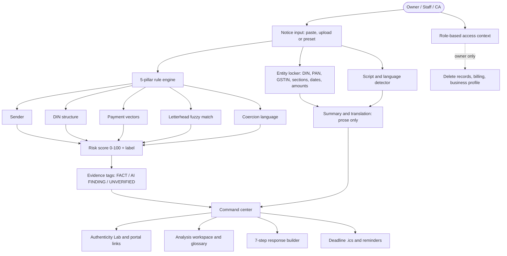

<div align="center">

<!-- TODO: add docs/assets/logo.svg and banner.png (850x340, #172C4D background, #B99A62 accent) -->

# ⚖️ Lexora

### Got a legal notice? Know in seconds if it looks fake, what it says in your language, and what to do before the deadline.

**Notice intelligence · Authenticity risk analysis · Vernacular summaries · Deadline command center, built for Indian MSMEs**

[](https://lex-orpin.vercel.app/app)
[]()
[](LICENSE)


[🚀 **Try it live**](https://lex-orpin.vercel.app/app) · [📺 Demo video](<!-- TODO: video URL -->) · [📂 Source](https://github.com/<!-- TODO: github-user -->/lexora)

<!-- TODO: add demo.gif (max 10MB): fake GST notice -> red flags -> Kannada summary -> .ics export -->


> **Lexora is decision support, not legal advice.** It estimates risk and never declares a notice genuine or fake. Always verify on the official portal and consult a CA or advocate.

</div>

---

## ⚡ 30-second summary

| | |
|---|---|
| **Who is it for?** | Small business owners who receive GST, Income Tax, EPFO or cheque-bounce notices and cannot tell a real one from a scam. |
| **What is the pain?** | Two bad outcomes: pay a scammer out of panic, or ignore a real notice and miss the deadline. |
| **What does Lexora do?** | Scores authenticity risk with transparent rules, explains the notice in plain English, Hindi or Kannada, and turns the deadline into a calendar reminder and a draft reply. |
| **What makes it different?** | Every finding shows its evidence and its type. Numbers, sections and IDs are **locked** so translation cannot corrupt them. We state clearly what we do **not** verify. |
| **Try it** | Open the [live app](https://lex-orpin.vercel.app/app), pick the fake GST preset, then the genuine Income Tax preset, and compare. |

---

## 🧭 Project highlights at a glance

| Area | Where to look | Quick proof (60 seconds) |
|---|---|---|
| **Innovation** | Evidence tags + entity locking + risk labels instead of verdicts | Open preset `notice-gst-scam-01`, then switch to Kannada and compare the amounts |
| **Real-world impact** | [The Problem](#-the-problem) | Fake notice vs genuine notice, side by side |
| **Technical depth** | [Architecture](#-architecture) and `src/services/` | Deterministic rule engine with explainable score |
| **Feasibility** | [Status table](#-features-and-honest-status) | Every feature tagged Implemented, Prototype or Planned |
| **Scalability** | [Business model](#-business-model-and-scale) | Client-side core means low marginal cost |
| **Completeness** | Roles, deadline sync, response builder | Switch Owner / Staff / CA from the header |
| **Honesty and trust** | [Trust model](#-trust-model-what-we-claim-and-what-we-dont) | Read the limits we publish ourselves |

---

## 🔥 The Problem

India has over **63 million MSMEs** *(Ministry of MSME; verify the exact figure and year before final submission)*. Most have no in-house legal team. When an official-looking notice arrives, an owner has minutes to decide, and a wrong call is expensive either way.

```text
              Official-looking notice arrives (GST / IT / EPFO / advocate)
                                   │
          ┌────────────────────────┴────────────────────────┐
          ▼                                                 ▼
   PANIC AND PAY                                    IGNORE AND MISS
 • Pay a private UPI handle                      • Miss a real reply window
 • Share OTPs or credentials                     • Face ex-parte orders or
 • Fall for "arrest in 24 hours"                   criminal complaints
```

1. **Impersonation scams.** Forged notices copy government letterheads, use lookalike domains and ask for payment to a personal UPI ID or QR code with an arrest threat.
2. **Language gap.** Notices arrive in formal English or Hindi, while many owners work in Kannada, Tamil, Gujarati and other languages.
3. **Real deadlines.** For example, under **Section 138 of the Negotiable Instruments Act**, the drawer has **15 days from receipt of the demand notice** to pay. If unpaid, the payee may file a *criminal complaint* within the following 30 days. It is **not** an ex-parte civil decree. For GST show cause notices, the reply window is stated on the notice itself *(TODO: verify the exact period for each notice type before showing it as a fixed figure)*.

> Industry-level numbers (scam losses, share of regional-language owners, notice volumes) are intentionally **not** quoted here because we could not source them. See [Impact](#-impact).

---

## 💡 Our Solution

```text
 Notice (paste / upload / preset)
        │
        ▼
 ① Lock the facts ──► ② Check authenticity risk ──► ③ Explain in your language ──► ④ Act before the deadline
   DIN, PAN, GSTIN      5 transparent pillars        plain-language summary         .ics reminder +
   sections, amounts    score 0-100 + evidence       numbers stay identical         7-step reply draft
```

**① Entity locking.** DINs, PANs, GSTINs, section citations, dates and rupee amounts are extracted and protected before any summary or translation. They come back character-for-character identical.

**② Authenticity risk (5 pillars).** Deterministic rules, no AI judgment:

| Pillar | What it checks | Honest scope |
|---|---|---|
| 1. Sender | Visible sender domain vs known official domains, lookalike similarity, free-mail senders | Compares the visible domain only. We do **not** query live mail records. |
| 2. DIN | Presence and structure of the Document Identification Number | Format check against a configured schema. Not a lookup in a government database. |
| 3. Payment | Personal UPI handles, QR or "scan to pay", personal account numbers | Pattern detection on notice text. |
| 4. Letterhead | Fuzzy match of authority names and references against a real-authority list | Approximate matching, not image forensics. |
| 5. Coercion | Arrest threats, 24/48-hour ultimatums, "do not consult a lawyer" | Language patterns plus timeline plausibility. |

**③ Vernacular summaries.** English, Hindi and Kannada, with locked entities and a plain-language glossary on hover.

**④ Deadline and response.** Calendar `.ics` with alarms at 7 days, 3 days and 1 day, browser reminders, and a guided 7-step reply draft for a CA to review.

---

## 🏷️ Evidence you can trust: three tags

Every finding in the Authenticity Lab carries one of these:

| Tag | Meaning | Example |
|---|---|---|
| `[VERIFIED FACT]` | A deterministic check on the text itself | "Payment handle `name@okaxis` is a personal UPI ID" |
| `[AI FINDING]` | An inference, not proof | "Tone resembles coercive demand language" |
| `[UNVERIFIED ASSERTION]` | A claim made *by the notice* that we cannot confirm | "Notice claims arrest within 48 hours" |

Result labels are limited to **Appears Genuine**, **Suspicious** and **Requires Direct Verification**. There is no "fake" or "100% genuine" label anywhere in the product.

---

## 🎬 Live Demo

**👉 [lex-orpin.vercel.app/app](https://lex-orpin.vercel.app/app)** *(no sign-up; seeded demo users)*

**Suggested 90-second tour**

1. Open **GST Demand Notice (DRC-01)** → see the risk score, red flags and evidence tags.
2. Open **Income Tax Scrutiny 143(2)** → compare the lower risk and the reasons.
3. Open **Karnataka GST SCN (bilingual)** → watch script detection, then switch to Kannada and confirm the amounts and sections did not change.
4. Open **Deadlines** → download the `.ics` file.
5. Open **Response** → generate the 7-step reply draft.
6. Switch role **Owner → Staff → CA** from the header → confirm only the Owner can delete or edit business details.

**Demo users:** Owner *Rajesh Sharma* · Staff *Priya Nair* · CA *Arvind Mehta, FCA* (seeded demo data, not real people).

---

## ✅ Features and honest status

| Feature | What the user gets | Status |
|---|---|---|
| Authenticity risk engine (5 pillars) | Score 0-100, label, reasons with evidence | **Implemented** |
| Evidence provenance tags | Clear separation of fact, inference and claim | **Implemented** |
| Entity locking | IDs, sections and amounts never altered | **Implemented** |
| Script detection | Kannada, Devanagari and Latin detected automatically | **Implemented** |
| Summaries and translation (EN / HI / KN) | Plain-language explanation in the owner's language | **Implemented** *(prose via AI proxy; see [AI scope](#-ai-scope))* |
| Legal glossary | Hover explanations for terms like *ex-parte* | **Implemented** |
| Deadline calendar `.ics` + reminders | Alarms at 7d / 3d / 1d | **Implemented** |
| 7-step response drafter | Structured draft for CA review, PDF export | **Implemented** |
| Role-based access (Owner / Staff / CA) | Owner-only delete, billing and profile edits | **Implemented** *(seeded demo login)* |
| Udyam number format check | Format validation and a link to the official portal | **Implemented** *(format only)* |
| OCR of scanned notices | Text extraction with a confidence value | **Prototype** *(sample data; see limits)* |
| WhatsApp intake bot | Forward a photo, get a triage reply | **Planned** |
| Government API verification via GSP | One-click live DIN lookup | **Planned** |

---

## 👥 Roles and Udyam

| Role | Can do | Cannot do |
|---|---|---|
| **Owner** | Everything: invite people, edit business and Udyam details, billing, delete records | n/a |
| **Staff** | Add notices, view findings, upload files, review drafts | Delete data, billing, edit company profile |
| **CA / Advisor** | Inspect evidence, annotate, review drafts, export briefs | Delete data, edit business profile |

**Udyam handling, stated plainly:**

- We validate the **format** `UDYAM-XX-00-0000000` and show *"Format checked, not verified with the government."*
- We link to the official Udyam site (`udyamregistration.gov.in`) so the owner can verify there.
- Udyam login on the official portal is owner-only (Aadhaar OTP). Lexora roles are separate and managed by the owner.
- We do **not** claim to verify Udyam, GST, PAN, Aadhaar or ownership with any government service.

---

## 🏗️ Architecture



**Design principles**

1. **Rules decide, AI explains.** Authenticity is never decided by a model.
2. **Show the evidence.** No score without reasons.
3. **Lock the facts.** Legal identifiers and amounts bypass translation.
4. **Admit the limits.** Scores are risk estimates and verification happens on official portals.

---

## 🧰 Tech stack

| Layer | Choice | Why |
|---|---|---|
| UI | React 18 + TypeScript (strict) | Typed legal and risk schemas, reliable multi-step flows |
| Styling | Tailwind CSS | Dense, consistent layout (`#172C4D` slate, `#B99A62` gold) |
| Build | Vite | Fast builds and hot reload |
| Icons | Lucide React | Lightweight, accessible icons |
| Forensics | Native TypeScript | Levenshtein, pattern rules and parsing run in the browser |
| Calendar | RFC 5545 generator | `.ics` with `VALARM` reminders for Google, Apple and Outlook |
| Hosting | Vercel | Public demo URL |

### 🤖 AI scope

The AI model is used **only** to rewrite and translate prose in summaries. It is never used to compute risk scores or decide authenticity. Locked entities are replaced by placeholders before text reaches the model and restored afterwards.

<!-- TODO: state exactly which model/API is used and confirm the API key is NOT exposed in browser code or network calls. If it is exposed, move the call behind a server function before submission. -->

---

## 🧪 Sample data and testing

All notices in the demo are **synthetic** and written to reflect commonly reported patterns. None is a real person's notice.

| Preset | Type | Expected label | Risk | Purpose |
|---|---|---|---|---|
| `notice-gst-scam-01` | GST DRC-01 style | Suspicious | 74 | Lookalike domain, malformed DIN, personal UPI, arrest threat |
| `notice-it-scrutiny-02` | Income Tax 143(2) style | Appears Genuine | 28 | Official-style domain, structured DIN, portal-only instructions |
| `notice-epfo-summons-04` | EPFO 7A summons | Appears Genuine | 28 | Regional summons with annexure requirements |
| `notice-cheque-bounce-03` | NI Act Section 138 | Requires Direct Verification | 51 | Private advocate sender, 15-day payment window |
| `notice-karnataka-commercial-tax-05` | Karnataka GST SCN (bilingual) | Appears Genuine | 8 | Kannada and English, script detection, GSTR-3B vs 2B mismatch |

<!-- TODO: re-run every preset in the live app and confirm these scores match exactly before submitting. -->

> These are demonstration cases, not a benchmark. We do not publish an accuracy figure because the sample set is small and synthetic.

---

## 🛡️ Trust model: what we claim and what we don't

| We do | We do not |
|---|---|
| Estimate risk from transparent, explainable rules | Declare any notice "fake" or "genuine" |
| Check the format and structure of IDs and payment handles | Verify IDs against live government databases |
| Show the evidence and its type for every finding | Hide reasoning behind a single number |
| Keep legal identifiers and amounts unchanged in translation | Let AI rewrite numbers, sections or dates |
| Send users to official portals to confirm | Replace a CA or advocate |
| Label demo data and seeded users clearly | Present sample data as real |

---

## 📈 Impact

**What the product measurably does today**

- Turns a notice into a structured summary: type, authority, date, section, amount, deadline and action.
- Produces a calendar file with three reminders per deadline.
- Keeps locked entities identical across English, Hindi and Kannada. *(You can verify this live with the Karnataka preset.)*

**Market context (verify and cite before submission)**

- Number of MSMEs in India: *Ministry of MSME Annual Report* <!-- TODO: add year and exact figure -->
- Active GST registrations: *GSTN statistics* <!-- TODO: add year and exact figure -->

**Outcome estimates** such as consultation savings are projections and should be labeled "illustrative estimate" with assumptions listed, or omitted if you cannot defend them.

---

## 💼 Business model and scale

| Tier | Price | For |
|---|---|---|
| Community | Free | A few analyses per month, authenticity scan, summaries, calendar export |
| MSME Pro | ₹999 / month *(proposed)* | Unlimited notices, full response builder, evidence vault |
| CA Suite | ₹4,999 / month *(proposed)* | Multi-client workspace, firm branding, white-label reports |

**Go-to-market:** Chartered Accountants and tax practitioners already receive panicked notice photos from clients. Giving them a fast triage tool brings their client base onto Lexora.

**Scale:** the rule engine runs in the browser, so analysis cost per notice stays low. A batch API for firms is planned.

---

## ⚠️ Limitations

| Limitation | Why | Plan |
|---|---|---|
| No live government verification | Official APIs need authorized GSP or ASP access and taxpayer consent | Deep links today; GSP sandbox integration planned |
| Offline analysis cannot prove authenticity | A document's text alone cannot confirm it was issued | Risk score plus portal verification steps |
| OCR is a prototype | Poor scans reduce accuracy | Confidence warning and manual text review |
| Udyam is format-checked only | Official verification needs the owner's Aadhaar OTP | Link to the official portal |
| Translation quality | Machine-generated regional text can be imperfect | Native-speaker review; entity locking protects numbers and sections |
| Complex litigation | Writs and appeals need advocate judgment | Exportable case brief for a lawyer |
| Demo login is seeded | Real authentication is not yet built | Phone/email OTP planned |

---

## 🗺️ Roadmap

**Done**
- [x] 5-pillar explainable risk engine
- [x] Evidence provenance tags
- [x] English, Hindi and Kannada with entity locking
- [x] Calendar `.ics` and reminders
- [x] Owner / Staff / CA roles with seeded demo users
- [x] 7-step response builder with PDF export


- [x] Real OCR with confidence score
- [x] Phone/email OTP login
- [x] Native-speaker review of Hindi and Kannada
- [x] WhatsApp intake bot


- [x] GSP sandbox integration for official verification
- [x] Tamil, Telugu, Marathi, Gujarati, Bengali
- [x] GSTR-2B vs purchase register reconciliation


- [x] Multi-client CA portal
- [x] Filing-portal integrations

---

## 🚀 Quick start

**Requirements:** Node.js 18+ and npm 9+

```bash
git clone https://github.com/<!-- TODO: github-user -->/lexora.git
cd lexora
npm install
npm run dev        # http://localhost:3000
```

```bash
npm run build      # type-check and production build
```

---

## 🎤 60-second pitch

> "Picture a factory owner in Bengaluru. An email arrives with a government emblem, says he owes GST, and demands payment to a QR code within 48 hours or face arrest. Does he pay? Or ignore it and risk a real default?
>
> Lexora gives him a third option. Paste the notice and Lexora shows, with evidence, whether it looks suspicious: the sender domain, the document ID, the payment handle, the threats. It never claims to know for sure. It tells him what to verify on the official portal.
>
> Then it explains the notice in Kannada, with every rupee amount and section number locked so translation cannot change them, and turns the deadline into a calendar reminder and a draft reply his CA can review.
>
> Lexora does not replace the CA. It makes sure the owner reaches the CA calm, informed and on time."

---

## ❓ Frequently asked questions

**Who is responsible if the score is wrong?**
Lexora is decision support. It never issues a verdict, shows every reason behind a score, and links to the official portals so the owner and their CA make the final call.

**Why not just ask a general chatbot?**
A chatbot usually assumes the uploaded notice is real. Lexora checks the notice first using fixed rules, labels each finding as fact, inference or claim, and keeps numbers and section citations from being altered in translation.

**Does AI decide if a notice is genuine?**
No. The five pillars are deterministic rules. AI is limited to rewriting and translating prose.

**How do you stop translation from corrupting numbers?**
Before translation, amounts, dates, sections, DINs, PANs and GSTINs are replaced with protected placeholders and restored unchanged afterwards. You can confirm this live in the Kannada view.

**Do you connect to government systems?**
Not yet. That needs authorized GSP access. Today we provide deep links and verification steps. Integration is on the roadmap.

**What if a scammer copies a valid-looking DIN?**
Structure is only one of five signals. Sender domain, payment handle, letterhead mismatch and coercive language still raise the score.

**How do you verify the user is genuine?**
We don't claim to. Udyam is format-checked only, and roles are assigned by the owner. Real verification needs official integrations, which are planned.

**What stops incumbents from copying this?**
Features are copyable. Trust, a curated pattern dataset, quality regional-language coverage and CA distribution are not.

**How will you reach the first 1,000 users?**
Through CAs and tax practitioners who already triage these notices for many clients.

---


## 📜 License and references

Licensed under **Apache-2.0**. See [LICENSE](LICENSE).

Statutory references *(verify numbers before submission)*:
- CBIC Circular No. 122/41/2019-GST (DIN on communications)
- CBDT Circular No. 19/2019 (DIN on communications)
- GSTN prescribed notice and order forms (DRC series)
- Ministry of MSME, Udyam Registration guidelines

---

<div align="center">
<sub>Built for India's small businesses. Turning legal panic into calm, structured action.</sub>
</div>
